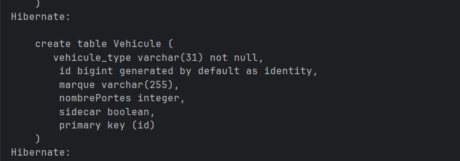
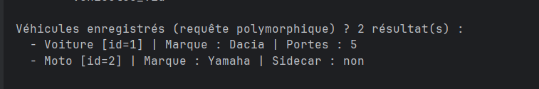
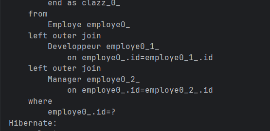
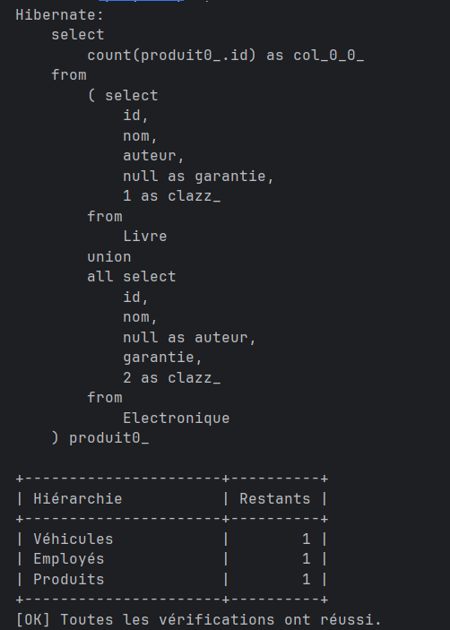
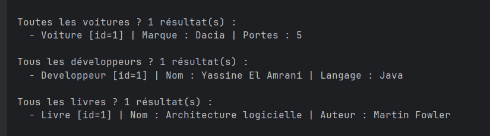
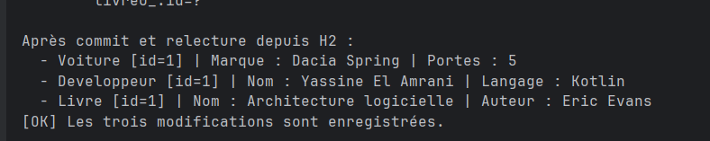
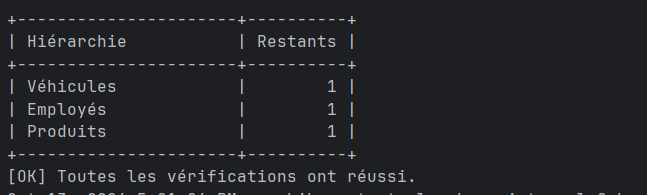
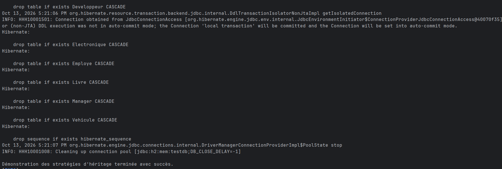

# TP - Héritage JPA avec Hibernate

## Captures d'écran d'exécution

### 1. Création de la table pour la stratégie SINGLE_TABLE

Cette capture montre la création de la table `Vehicule`. Les classes `Voiture` et `Moto` sont stockées dans la même table. La colonne `vehicule_type` permet à Hibernate de distinguer les différents sous-types.

### 2. Résultat de la stratégie SINGLE_TABLE

Cette capture montre le résultat de la requête polymorphique sur les véhicules. Hibernate récupère une `Voiture` et une `Moto` à partir de la même table tout en conservant leur type concret.

### 3. Requête générée avec la stratégie JOINED

Cette capture montre que Hibernate utilise des jointures entre la table `Employe` et les tables spécifiques `Developpeur` et `Manager`. Cela correspond au fonctionnement de la stratégie d’héritage `JOINED`.

### 4. Requête générée avec la stratégie TABLE_PER_CLASS

Cette capture montre que les classes concrètes `Livre` et `Electronique` utilisent des tables différentes. Hibernate effectue une opération `UNION` pour obtenir une liste polymorphique des produits.

### 5. Recherches par type

Cette capture montre les recherches spécifiques effectuées sur chaque hiérarchie. Les résultats affichent uniquement les voitures, les développeurs et les livres enregistrés dans la base.

### 6. Modification des entités

Cette capture montre les valeurs après modification et relecture depuis la base H2. Elle permet de vérifier que les modifications apportées aux différentes hiérarchies ont bien été enregistrées.

### 7. État final des données

Cette capture affiche le nombre d’éléments restants dans chaque hiérarchie après les différentes opérations. Elle confirme également que les vérifications finales ont réussi.

### 8. Fin de l’exécution

Cette dernière capture montre la fermeture de la base H2 et la fin normale de l’application. Le message affiché confirme que la démonstration des stratégies d’héritage s’est terminée avec succès.

